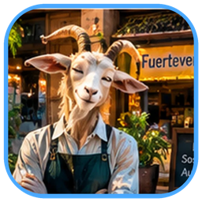

# Island Crew Suite

[🇪🇸 Español](README.md) · 🇬🇧 English

Desktop suite by **Island Crew Marketing**: four independent programs plus a monitor panel on the Desktop, each with its own native window on Mac and Windows, available in Spanish, English, Italian and German.

| | Program | What it does |
|---|---|---|
|  | **Carta Viva** | The restaurant menu with one video per dish, QR code, flyers and a translated public menu. |
|  | **Publicaciones y calendario** | A ready-made month of posts: texts, pieces per format and the daily package. |
|  | **Anuncios (Ads)** | Ads for dishes and offers in feed, story, square, screen and video formats. |
|  | **Cabra Beats** | Jingles and songs for any business. |
|  | **Suite (monitor)** | Panel showing the status of the four programs and the Intelligence Center. |

## Intelligence Center
A dashboard built on real data from the programs: global indicators, per-unit panels (Cabra Beats, Carta Viva, Cabra Social), period comparison, business analyst, alerts, manual finance and PDF reports. Anything not recorded shows as "no data"; nothing is invented.

## Connections
A "Connections" screen with a four-step guide to connect Instagram, Facebook and YouTube. Keys are stored only on the user's computer, never in the package. Automatic YouTube upload uses the Cabra Beats engine.

## Structure
- `scripts/suite/` · panel, licences, native window, installers, Intelligence Center.
- `scripts/carta-viva/`, `scripts/publicaciones/`, `scripts/anuncios/` · the programs.
- `scripts/cabra-beats-*`, `scripts/fabrica-*` · Cabra Beats and the music, voice and video engines.

Work by Maximiliano Olmos Sánchez for Island Crew Marketing. All rights reserved. Contact: hola@islandcrew.es
